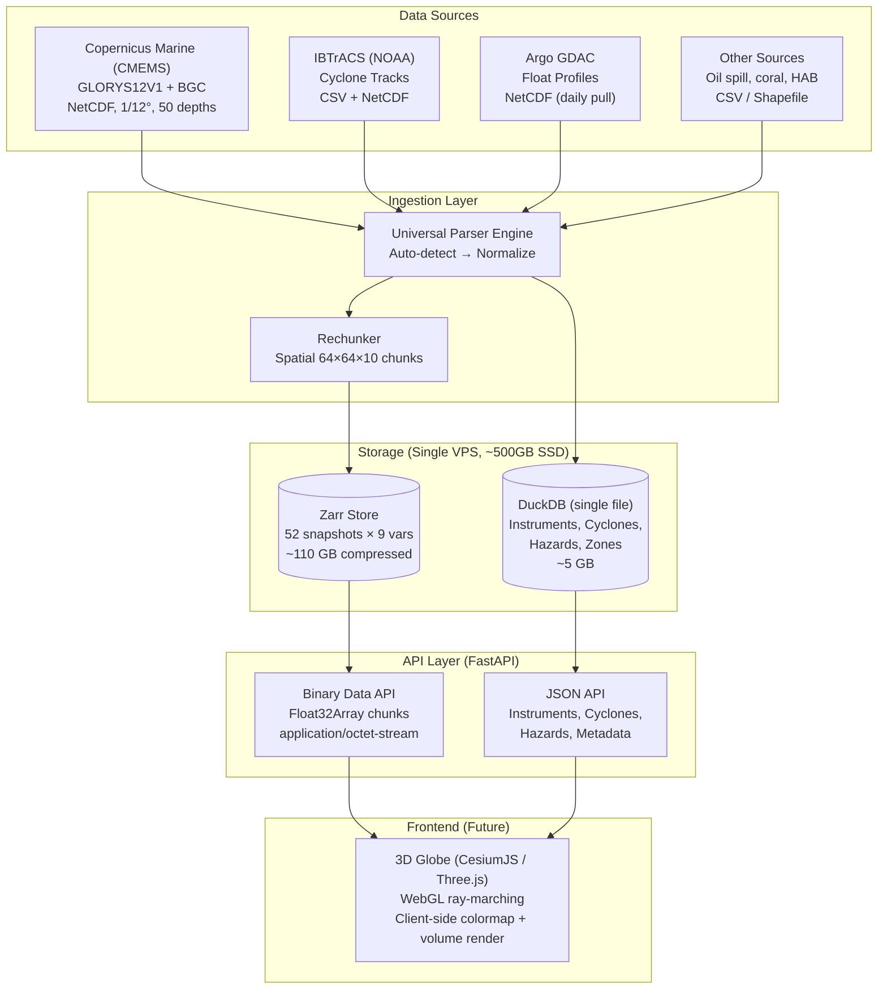
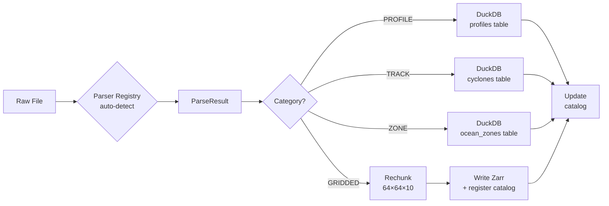

# POLARIS v2 — Backend Architecture (Raw Data API for 3D Volumetric Rendering)

> **Key change from v1**: The API returns **raw binary data arrays** (Float32Array), not image tiles. The frontend receives numeric grid chunks and performs all 3D volumetric rendering via WebGL/WebGPU — colormapping, isosurface extraction, ray-marching — entirely client-side.

---

## Architecture Overview



---

## 1. Data Source: Copernicus Marine Service (CMEMS)

### Why CMEMS over HYCOM/NCEP

| Criteria | CMEMS | HYCOM | NCEP |
|:---|:---|:---|:---|
| **Resolution** | 1/12° (~9 km) ✅ | 1/12° (~9 km) | ~1° (too coarse) ❌ |
| **Depth levels** | 50 ✅ | 40 | 23-40 |
| **Physics vars** | Temp, Salinity, Currents, SSH, MLD ✅ | Temp, Salinity, Currents, SSH ✅ | Temp, Salinity |
| **Biogeochem** | Chlorophyll, O₂, NO₃, PO₄, Si ✅ | ❌ (separate product) | ❌ |
| **Time coverage** | 1993–present ✅ | 1994–present | 1979–present ✅ |
| **Free access** | Yes (registration) ✅ | Yes ✅ | Yes ✅ |
| **Download API** | Python toolbox ✅ | OPeNDAP | FTP |
| **Quality** | Data-assimilated reanalysis ✅ | Real-time forecast | Reanalysis |

> [!TIP]
> **CMEMS is the winner** — it's the only single source that covers all your variables (physics + biogeochemistry) at ~9 km resolution with 50 depth levels and a proper Python download toolbox. We use two products:
> - **`GLOBAL_MULTIYEAR_PHY_001_030`** (GLORYS12V1) → temperature, salinity, currents, SSH
> - **`GLOBAL_ANALYSISFORECAST_BGC_001_028`** → chlorophyll, dissolved O₂, nitrate, phosphate, silicate

### Spatial Subset: Indian Ocean Region

To keep storage manageable on a single VPS, we subset to the **Indian Ocean + Bay of Bengal + Arabian Sea**:

```
Region: 30°E – 120°E, 40°S – 30°N
Grid size: ~1080 × 840 × 50 depths
Per variable per snapshot: ~180 MB (compressed Zarr)
```

> [!NOTE]
> If you later want global coverage, the architecture scales — just increase storage. The chunking and API remain identical.

---

## 2. Storage Architecture

### 2.1 Design Principle: Raw Data, Not Images

Since the frontend does all rendering, the backend's job is:
1. **Store** gridded data in a format that allows fast partial reads by (lat, lon, depth, time)
2. **Serve** raw numeric arrays as binary `Float32Array` buffers to the frontend
3. **Index** point/event data (instruments, cyclones) for fast spatial + temporal queries

### 2.2 Zarr Store — Gridded 3D/4D Ocean Fields

#### Layout

```
data/
├── zarr/
│   ├── temperature/
│   │   ├── yearly/
│   │   │   ├── 2017.zarr/     # Each .zarr/ is a self-contained store
│   │   │   ├── 2018.zarr/     # containing lat × lon × depth arrays
│   │   │   └── ...            # (10 stores)
│   │   ├── monthly/
│   │   │   ├── 2025-10.zarr/
│   │   │   └── ...            # (12 stores)
│   │   └── daily/
│   │       ├── 2026-08-22.zarr/
│   │       └── ...            # (30 stores)
│   ├── salinity/
│   │   └── yearly/ monthly/ daily/
│   ├── u_current/
│   ├── v_current/
│   ├── ssh/                   # 2D only (no depth)
│   ├── chlorophyll/
│   ├── dissolved_oxygen/
│   ├── nitrate/
│   └── phosphate/
│
└── polaris.duckdb              # Single-file embedded DB
```

#### Chunking Strategy

```python
# Indian Ocean grid: ~1080 lon × 840 lat × 50 depth
# Frontend requests data for a viewport region at a specific depth range

CHUNK_CONFIG = {
    'lon': 64,      # 64 grid points per chunk (~5.3° per chunk)
    'lat': 64,      # 64 grid points per chunk (~5.3° per chunk)
    'depth': 10,    # 10 depth levels per chunk (surface detail)
}

# Chunk size: 64 × 64 × 10 × 4 bytes = ~160 KB per chunk
# Small enough for quick HTTP transfer, large enough to avoid metadata overhead
# A typical viewport at zoom level showing ~20° × 20° loads ~16 chunks = ~2.5 MB
```

> [!IMPORTANT]
> **Why 64×64×10 and not 256×256?** Because we're sending raw numeric data, not rendered images. Smaller chunks = the frontend can request exactly the region visible in the 3D viewport without loading unnecessary data. 160 KB per chunk transfers in ~20ms even on a 64 Mbps connection.

#### Storage Size Estimates

| Component | Calculation | Size |
|:---|:---|:---|
| 1 variable × 1 snapshot | 1080×840×50 × 4 bytes × 0.4 (Zarr compression) | ~73 MB |
| 9 variables × 52 snapshots | 73 MB × 468 | **~34 GB** |
| SSH (2D only, 52 snapshots) | 1080×840 × 4 × 0.4 × 52 | ~75 MB |
| DuckDB (instruments, cyclones, zones) | 10M+ rows | **~5 GB** |
| Raw archive (original NetCDF files) | Optional, for reprocessing | ~60 GB |
| **Total** | | **~100 GB** |

> [!TIP]
> **~100 GB total** fits easily on a single VPS with a 250–500 GB SSD. No object storage or distributed filesystem needed.

### 2.3 DuckDB — Point Data, Events, Metadata

```sql
-- ============================================================
-- INSTRUMENT REGISTRY (Argo floats, Gliders, CTDs, moorings)
-- ============================================================
CREATE TABLE instruments (
    instrument_id    VARCHAR PRIMARY KEY,   -- WMO ID e.g. "2901234"
    instrument_type  VARCHAR NOT NULL,      -- 'argo_float','glider','ctd','mooring'
    platform_name    VARCHAR,
    deploy_date      TIMESTAMP,
    last_report      TIMESTAMP,
    status           VARCHAR,               -- 'active','inactive','recovered'
    metadata_json    JSON,
    geom             GEOMETRY               -- POINT(lon, lat)
);
CREATE INDEX idx_instr_geom ON instruments USING RTREE (geom);

-- ============================================================
-- INSTRUMENT PROFILES (depth-resolved observations)
-- ============================================================
CREATE TABLE profiles (
    profile_id       BIGINT PRIMARY KEY,
    instrument_id    VARCHAR NOT NULL,
    observation_time TIMESTAMP NOT NULL,
    lat              DOUBLE NOT NULL,
    lon              DOUBLE NOT NULL,
    depth            DOUBLE NOT NULL,
    temperature      DOUBLE,
    salinity         DOUBLE,
    dissolved_oxygen DOUBLE,
    chlorophyll      DOUBLE,
    nitrate          DOUBLE,
    phosphate        DOUBLE,
    qc_flag          SMALLINT DEFAULT 0,
    geom             GEOMETRY
);
CREATE INDEX idx_prof_geom ON profiles USING RTREE (geom);
CREATE INDEX idx_prof_time ON profiles (observation_time);
CREATE INDEX idx_prof_instr ON profiles (instrument_id);

-- ============================================================
-- INSTRUMENT TRACKS (float/glider trajectory positions)
-- ============================================================
CREATE TABLE instrument_tracks (
    track_id         BIGINT PRIMARY KEY,
    instrument_id    VARCHAR NOT NULL,
    observation_time TIMESTAMP NOT NULL,
    lat              DOUBLE NOT NULL,
    lon              DOUBLE NOT NULL,
    depth            DOUBLE,
    speed            DOUBLE,
    heading          DOUBLE,
    geom             GEOMETRY
);
CREATE INDEX idx_track_geom ON instrument_tracks USING RTREE (geom);

-- ============================================================
-- TROPICAL CYCLONES (IBTrACS + JTWC + IMD)
-- ============================================================
CREATE TABLE cyclones (
    storm_id         VARCHAR NOT NULL,       -- IBTrACS SID
    basin            VARCHAR,
    name             VARCHAR,
    season           INTEGER,
    observation_time TIMESTAMP NOT NULL,
    lat              DOUBLE NOT NULL,
    lon              DOUBLE NOT NULL,
    max_wind_kts     DOUBLE,
    min_pressure_hpa DOUBLE,
    storm_category   VARCHAR,               -- 'TD','TS','C1'...'C5'
    storm_speed_kph  DOUBLE,
    storm_dir_deg    DOUBLE,
    wind_radii_json  JSON,
    is_current       BOOLEAN DEFAULT FALSE,
    source           VARCHAR,
    geom             GEOMETRY
);
CREATE INDEX idx_cyc_geom ON cyclones USING RTREE (geom);
CREATE INDEX idx_cyc_storm ON cyclones (storm_id);
CREATE INDEX idx_cyc_time ON cyclones (observation_time);

-- ============================================================
-- HAZARD EVENTS
-- ============================================================
CREATE TABLE hazard_events (
    event_id         BIGINT PRIMARY KEY,
    hazard_type      VARCHAR NOT NULL,       -- 'marine_heatwave','coral_bleaching',
                                             -- 'dead_zone','harmful_algal_bloom',
                                             -- 'oil_spill','tsunami'
    name             VARCHAR,
    severity         VARCHAR,
    start_time       TIMESTAMP,
    end_time         TIMESTAMP,
    lat              DOUBLE,
    lon              DOUBLE,
    geom             GEOMETRY,               -- POLYGON or POINT
    properties_json  JSON,
    source           VARCHAR,
    source_url       VARCHAR
);
CREATE INDEX idx_haz_geom ON hazard_events USING RTREE (geom);
CREATE INDEX idx_haz_type ON hazard_events (hazard_type);

-- ============================================================
-- OCEAN ZONES (fishing spots, dead zones, MPAs)
-- ============================================================
CREATE TABLE ocean_zones (
    zone_id          BIGINT PRIMARY KEY,
    zone_type        VARCHAR NOT NULL,       -- 'fishing_spot','dead_zone',
                                             -- 'anomaly_region','marine_protected_area'
    name             VARCHAR,
    description      TEXT,
    valid_from       TIMESTAMP,
    valid_until      TIMESTAMP,
    geom             GEOMETRY,               -- POLYGON
    properties_json  JSON,
    source           VARCHAR
);
CREATE INDEX idx_zone_geom ON ocean_zones USING RTREE (geom);

-- ============================================================
-- DATASET CATALOG (registry of all ingested data)
-- ============================================================
CREATE TABLE dataset_catalog (
    dataset_id       VARCHAR PRIMARY KEY,
    dataset_name     VARCHAR NOT NULL,
    category         VARCHAR NOT NULL,       -- 'gridded','profile','track','zone'
    variables        JSON,
    temporal_type    VARCHAR,                -- 'yearly','monthly','daily'
    time_key         VARCHAR,                -- '2026','2026-09','2026-09-20'
    time_start       TIMESTAMP,
    time_end         TIMESTAMP,
    lat_min          DOUBLE,
    lat_max          DOUBLE,
    lon_min          DOUBLE,
    lon_max          DOUBLE,
    depth_min        DOUBLE,
    depth_max        DOUBLE,
    storage_path     VARCHAR,
    source_format    VARCHAR,
    chunk_shape      JSON,                   -- {"lon":64,"lat":64,"depth":10}
    file_size_bytes  BIGINT,
    ingested_at      TIMESTAMP DEFAULT CURRENT_TIMESTAMP,
    metadata_json    JSON
);
```

---

## 3. Universal Parser Engine

### 3.1 Plugin Architecture

```
polaris/parsers/
├── base.py              # BaseParser ABC + ParseResult dataclass
├── registry.py          # Auto-detection router
├── netcdf_parser.py     # CMEMS GLORYS12, BGC, ROMS, HYCOM
├── csv_parser.py        # IBTrACS cyclones, instrument logs, generic
├── shapefile_parser.py  # Cyclone tracks, zone polygons
├── argo_parser.py       # Argo GDAC profiles via argopy library
└── grib_parser.py       # GRIB2 weather/ocean forecasts
```

### 3.2 Base Interface

```python
from abc import ABC, abstractmethod
from dataclasses import dataclass, field
from enum import Enum
from typing import Optional
import xarray as xr
import pandas as pd

class DataCategory(Enum):
    GRIDDED_FIELD = "gridded"      # 3D/4D temp, salinity, current grids
    POINT_PROFILE = "profile"      # Argo/Glider depth profiles
    TRACK_EVENT   = "track"        # Cyclone tracks, ship routes
    ZONE_POLYGON  = "zone"         # Dead zones, fishing areas, MPAs

@dataclass
class ParseResult:
    category: DataCategory
    gridded: Optional[xr.Dataset] = None       # For GRIDDED_FIELD
    tabular: Optional[pd.DataFrame] = None     # For POINT/TRACK/ZONE
    metadata: dict = field(default_factory=dict)
    variables: list[str] = field(default_factory=list)
    time_range: Optional[tuple] = None         # (start_dt, end_dt)
    spatial_bounds: Optional[dict] = None      # {lat_min, lat_max, lon_min, lon_max}

class BaseParser(ABC):
    @abstractmethod
    def can_parse(self, filepath: str) -> bool:
        """Return True if this parser handles the given file."""

    @abstractmethod
    def parse(self, filepath: str, **kwargs) -> ParseResult:
        """Parse file → normalized ParseResult."""

    @abstractmethod
    def supported_extensions(self) -> list[str]:
        """File extensions this parser handles."""
```

### 3.3 NetCDF Parser (CMEMS, HYCOM, ROMS)

```python
class NetCDFParser(BaseParser):
    """Handles CMEMS GLORYS12V1, BGC products, HYCOM, ROMS outputs."""

    # CF-Convention variable name → canonical name
    VARIABLE_ALIASES = {
        # Temperature
        "thetao": "temperature",     # CMEMS/GLORYS
        "water_temp": "temperature", # HYCOM
        "temp": "temperature",       # ROMS
        "sea_water_potential_temperature": "temperature",
        # Salinity
        "so": "salinity",            # CMEMS/GLORYS
        "salinity": "salinity",      # HYCOM
        "salt": "salinity",          # ROMS
        "sea_water_salinity": "salinity",
        # Currents
        "uo": "u_current",           # CMEMS
        "vo": "v_current",           # CMEMS
        "water_u": "u_current",      # HYCOM
        "water_v": "v_current",      # HYCOM
        "u": "u_current",            # ROMS
        "v": "v_current",            # ROMS
        # SSH
        "zos": "ssh",               # CMEMS
        "surf_el": "ssh",           # HYCOM
        "zeta": "ssh",              # ROMS
        # Biogeochemistry
        "chl": "chlorophyll",
        "o2": "dissolved_oxygen",
        "no3": "nitrate",
        "po4": "phosphate",
        "si": "silicate",
    }

    DIMENSION_ALIASES = {
        # lat
        "latitude": "lat", "y": "lat", "eta_rho": "lat", "nlat": "lat",
        # lon
        "longitude": "lon", "x": "lon", "xi_rho": "lon", "nlon": "lon",
        # depth
        "depth": "depth", "lev": "depth", "z": "depth", "s_rho": "depth",
        "deptht": "depth",
        # time
        "time": "time", "ocean_time": "time", "time_counter": "time",
    }

    def can_parse(self, filepath: str) -> bool:
        return any(filepath.endswith(ext) for ext in self.supported_extensions())

    def supported_extensions(self) -> list[str]:
        return ['.nc', '.nc4', '.hdf5', '.h5']

    def parse(self, filepath: str, **kwargs) -> ParseResult:
        ds = xr.open_dataset(filepath, engine='netcdf4', chunks='auto')

        # 1. Normalize dimensions to standard names
        dim_map = {}
        for dim in ds.dims:
            canonical = self.DIMENSION_ALIASES.get(dim.lower())
            if canonical and dim != canonical:
                dim_map[dim] = canonical
        if dim_map:
            ds = ds.rename(dim_map)

        # 2. Normalize variable names
        var_map = {}
        for var in list(ds.data_vars):
            canonical = self.VARIABLE_ALIASES.get(var.lower())
            if canonical and var != canonical:
                var_map[var] = canonical
        if var_map:
            ds = ds.rename(var_map)

        # 3. Handle ROMS sigma → z-level conversion
        if self._is_roms(ds):
            ds = self._convert_sigma_to_z(ds)

        # 4. Ensure consistent coordinate ordering (lat ascending, lon ascending)
        if 'lat' in ds.coords and ds.lat.values[0] > ds.lat.values[-1]:
            ds = ds.isel(lat=slice(None, None, -1))

        return ParseResult(
            category=DataCategory.GRIDDED_FIELD,
            gridded=ds,
            metadata=dict(ds.attrs),
            variables=[v for v in ds.data_vars if v in self.VARIABLE_ALIASES.values()],
            time_range=(
                pd.Timestamp(ds.time.values[0]) if 'time' in ds.dims else None,
                pd.Timestamp(ds.time.values[-1]) if 'time' in ds.dims else None,
            ),
            spatial_bounds={
                'lat_min': float(ds.lat.min()),
                'lat_max': float(ds.lat.max()),
                'lon_min': float(ds.lon.min()),
                'lon_max': float(ds.lon.max()),
            },
        )

    def _is_roms(self, ds: xr.Dataset) -> bool:
        return 'Cs_r' in ds or 's_rho' in ds.dims

    def _convert_sigma_to_z(self, ds: xr.Dataset) -> xr.Dataset:
        """Convert ROMS terrain-following coordinates to fixed z-levels."""
        # Uses Vtransform equations with h, hc, Cs_r
        import numpy as np
        standard_depths = np.array([
            0, 5, 10, 15, 20, 25, 30, 40, 50, 75,
            100, 125, 150, 200, 250, 300, 400, 500, 600, 700,
            800, 900, 1000, 1100, 1200, 1300, 1400, 1500, 1750, 2000,
            2500, 3000, 3500, 4000, 4500, 5000
        ])
        # Interpolation logic for ROMS sigma → z
        # ... (detailed implementation based on Vtransform version)
        ds = ds.rename({'s_rho': 'depth'})
        ds = ds.assign_coords(depth=standard_depths[:len(ds.depth)])
        return ds
```

### 3.4 CSV Parser (IBTrACS, Generic)

```python
class CSVParser(BaseParser):
    """Handles IBTrACS cyclone data, instrument logs, generic ocean CSVs."""

    FORMAT_SIGNATURES = {
        'ibtracs': {
            'columns': {'SID', 'ISO_TIME', 'LAT', 'LON', 'WMO_WIND', 'WMO_PRES'},
            'category': DataCategory.TRACK_EVENT,
            'column_map': {
                'SID': 'storm_id', 'NAME': 'name', 'SEASON': 'season',
                'BASIN': 'basin', 'ISO_TIME': 'observation_time',
                'LAT': 'lat', 'LON': 'lon',
                'WMO_WIND': 'max_wind_kts', 'WMO_PRES': 'min_pressure_hpa',
                'STORM_SPEED': 'storm_speed_kph', 'STORM_DIR': 'storm_dir_deg',
                'USA_SSHS': 'storm_category',
            },
        },
        'instrument_log': {
            'columns': {'lat', 'lon', 'depth', 'temperature'},
            'category': DataCategory.POINT_PROFILE,
            'column_map': {},  # Already canonical names
        },
    }

    def can_parse(self, filepath: str) -> bool:
        return any(filepath.endswith(ext) for ext in self.supported_extensions())

    def supported_extensions(self) -> list[str]:
        return ['.csv', '.tsv', '.txt', '.dat']

    def parse(self, filepath: str, **kwargs) -> ParseResult:
        df = pd.read_csv(filepath, sep=None, engine='python',
                         na_values=[' ', '', '-9999', '-9999.0'])

        fmt_key = kwargs.get('format_hint') or self._detect_format(df)
        fmt = self.FORMAT_SIGNATURES.get(fmt_key, {})

        # Rename columns
        if fmt.get('column_map'):
            df = df.rename(columns=fmt['column_map'])

        # Parse timestamps
        time_col = 'observation_time' if 'observation_time' in df.columns else None
        if time_col:
            df[time_col] = pd.to_datetime(df[time_col], errors='coerce')

        return ParseResult(
            category=fmt.get('category', DataCategory.POINT_PROFILE),
            tabular=df,
            variables=list(df.columns),
            time_range=(df[time_col].min(), df[time_col].max()) if time_col else None,
            spatial_bounds={
                'lat_min': float(df['lat'].min()),
                'lat_max': float(df['lat'].max()),
                'lon_min': float(df['lon'].min()),
                'lon_max': float(df['lon'].max()),
            } if {'lat', 'lon'}.issubset(df.columns) else None,
        )

    def _detect_format(self, df: pd.DataFrame) -> str:
        cols = set(df.columns)
        for name, sig in self.FORMAT_SIGNATURES.items():
            if sig['columns'].issubset(cols):
                return name
        return 'generic'
```

### 3.5 Argo Parser (via argopy)

```python
class ArgoParser(BaseParser):
    """Fetch and parse Argo float profiles from the GDAC."""

    def can_parse(self, filepath: str) -> bool:
        # Also handles "argo://" virtual paths for GDAC fetch
        return filepath.startswith('argo://') or 'argo' in filepath.lower()

    def supported_extensions(self) -> list[str]:
        return ['.nc']  # Argo profiles are NetCDF

    def parse(self, filepath: str, **kwargs) -> ParseResult:
        import argopy

        if filepath.startswith('argo://'):
            # Virtual path: argo://region/30,120,-40,30/last_30_days
            loader = argopy.DataFetcher(src='gdac')
            box = kwargs.get('box', [30, 120, -40, 30])  # Indian Ocean
            ds = loader.region(box).to_xarray()
        else:
            ds = xr.open_dataset(filepath)

        # Convert to flat DataFrame for DuckDB storage
        df = ds.to_dataframe().reset_index()
        df = df.rename(columns={
            'LATITUDE': 'lat', 'LONGITUDE': 'lon',
            'PRES': 'depth', 'TEMP': 'temperature',
            'PSAL': 'salinity', 'DOXY': 'dissolved_oxygen',
            'CHLA': 'chlorophyll',
            'JULD': 'observation_time',
            'PLATFORM_NUMBER': 'instrument_id',
        })

        return ParseResult(
            category=DataCategory.POINT_PROFILE,
            tabular=df,
            variables=['temperature', 'salinity', 'dissolved_oxygen', 'chlorophyll'],
            time_range=(df['observation_time'].min(), df['observation_time'].max()),
            spatial_bounds={
                'lat_min': float(df['lat'].min()),
                'lat_max': float(df['lat'].max()),
                'lon_min': float(df['lon'].min()),
                'lon_max': float(df['lon'].max()),
            },
        )
```

---

## 4. Binary Data API (The Core Change)

### 4.1 Design Principle

The frontend renders a **3D volumetric globe**. When a user navigates the globe, the frontend needs **raw numeric arrays** to:
- Build 3D textures for volume ray-marching
- Compute isosurfaces on the GPU
- Color-map values client-side with user-chosen palettes

Therefore every gridded data endpoint returns **binary `Float32Array` buffers** with metadata in HTTP headers — not JSON, not images.

### 4.2 Binary Response Protocol

```
HTTP/1.1 200 OK
Content-Type: application/octet-stream
X-Data-Shape: 64,64,10          ← dimensions: [lon, lat, depth]
X-Data-Dtype: float32
X-Lat-Min: 5.0
X-Lat-Max: 10.3
X-Lon-Min: 72.0
X-Lon-Max: 77.3
X-Depth-Levels: 0,5,10,15,20,25,30,40,50,75
X-Variable: temperature
X-Units: degree_Celsius
X-Time-Key: 2026-09-20
X-Value-Min: 4.2                ← for client-side colormap scaling
X-Value-Max: 31.7
X-NaN-Value: -9999.0            ← sentinel for land/missing

[binary body: 64 × 64 × 10 × 4 = 163,840 bytes of float32 data]
```

**Frontend consumption:**
```javascript
const response = await fetch('/api/v1/data/temperature/daily/2026-09-20?...');
const shape = response.headers.get('X-Data-Shape').split(',').map(Number);
const buffer = await response.arrayBuffer();
const data = new Float32Array(buffer);
// data is now [64×64×10] array ready for gl.texImage3D()
```

### 4.3 API Endpoints

#### Gridded Data (Binary)

```
GET /api/v1/data/{variable}/{tier}/{time_key}
    ?lat_min=5&lat_max=20&lon_min=70&lon_max=90
    &depth_min=0&depth_max=500
    
Returns: Binary Float32Array of shape [lon_chunks, lat_chunks, depth_chunks]
Headers: X-Data-Shape, X-Lat-Min/Max, X-Lon-Min/Max, X-Depth-Levels, etc.
```

```
GET /api/v1/data/{variable}/{tier}/{time_key}/slice
    ?lat_min=5&lat_max=20&lon_min=70&lon_max=90
    &depth=100
    
Returns: Binary Float32Array of shape [lon_chunks, lat_chunks] (single depth)
Headers: X-Data-Shape, X-Depth: 100, etc.
```

```
GET /api/v1/data/{variable}/{tier}/{time_key}/column
    ?lat=12.5&lon=80.3
    
Returns: Binary Float32Array of shape [n_depths] (single point, all depths)
Headers: X-Data-Shape, X-Depth-Levels, etc.
Use case: Click a point on the globe → see depth profile
```

#### Metadata (JSON)

```
GET /api/v1/datasets
    Returns: List of available datasets, variables, time ranges, bounds

GET /api/v1/datasets/{dataset_id}/metadata
    Returns: Full metadata including chunk shape, depth levels, units

GET /api/v1/variables
    Returns: List of all available variables with units and ranges

GET /api/v1/timeline/{variable}
    Returns: Available time keys for each tier (yearly/monthly/daily)
```

#### Instruments (JSON)

```
GET /api/v1/instruments
    ?bbox=70,5,90,25&type=argo_float&status=active
    Returns: Array of instrument objects with positions

GET /api/v1/instruments/{id}/profile
    ?time_start=2026-09-01&time_end=2026-09-20
    Returns: Depth-vs-variable profile data

GET /api/v1/instruments/{id}/track
    Returns: Array of positions for trajectory rendering
```

#### Cyclones (JSON)

```
GET /api/v1/hazards/cyclones
    ?bbox=60,0,100,30&season=2026&active_only=true
    Returns: Array of storm objects, each with positions array for track rendering

GET /api/v1/hazards/cyclones/{storm_id}
    Returns: Full track with all metadata for a single storm
```

#### Hazards & Zones (JSON)

```
GET /api/v1/hazards/{type}
    ?bbox=...&severity=severe
    Types: marine_heatwave, coral_bleaching, dead_zone, 
           harmful_algal_bloom, oil_spill, tsunami

GET /api/v1/zones
    ?type=fishing_spot&bbox=...
    Types: fishing_spot, dead_zone, anomaly_region, marine_protected_area
```

### 4.4 Implementation

```python
# api/routes/data.py — The core binary data endpoint

from fastapi import APIRouter, Query, Response
import xarray as xr
import numpy as np
from polaris.config import settings

router = APIRouter(prefix="/api/v1/data")

@router.get("/{variable}/{tier}/{time_key}")
async def get_volume_chunk(
    variable: str,
    tier: str,               # "daily", "monthly", "yearly"
    time_key: str,           # "2026-09-20", "2026-09", "2026"
    lat_min: float = Query(...),
    lat_max: float = Query(...),
    lon_min: float = Query(...),
    lon_max: float = Query(...),
    depth_min: float = Query(0.0),
    depth_max: float = Query(5000.0),
):
    """
    Return raw Float32Array binary data for a 3D volume chunk.
    The frontend uses this directly as a WebGL 3D texture.
    """
    # 1. Open the correct Zarr store
    zarr_path = f"{settings.ZARR_ROOT}/{variable}/{tier}/{time_key}.zarr"
    ds = xr.open_zarr(zarr_path, consolidated=True)

    # 2. Slice to requested region + depth range
    data = ds[variable].sel(
        lat=slice(lat_min, lat_max),
        lon=slice(lon_min, lon_max),
        depth=slice(depth_min, depth_max),
    )

    # 3. Load into memory and convert to float32
    values = data.values.astype(np.float32)

    # 4. Replace NaN with sentinel for WebGL (NaN not reliable in GLSL)
    nan_sentinel = -9999.0
    values = np.where(np.isnan(values), nan_sentinel, values)

    # 5. Get actual coordinate arrays for headers
    lats = data.lat.values
    lons = data.lon.values
    depths = data.depth.values if 'depth' in data.dims else np.array([0])

    # 6. Return raw binary with metadata in headers
    return Response(
        content=values.tobytes(),
        media_type="application/octet-stream",
        headers={
            "X-Data-Shape": f"{values.shape[0]},{values.shape[1]},{values.shape[2]}",
            "X-Data-Dtype": "float32",
            "X-Lat-Min": str(float(lats.min())),
            "X-Lat-Max": str(float(lats.max())),
            "X-Lon-Min": str(float(lons.min())),
            "X-Lon-Max": str(float(lons.max())),
            "X-Depth-Levels": ",".join(str(d) for d in depths),
            "X-Variable": variable,
            "X-Units": ds[variable].attrs.get("units", "unknown"),
            "X-Time-Key": time_key,
            "X-Value-Min": str(float(np.nanmin(data.values))),
            "X-Value-Max": str(float(np.nanmax(data.values))),
            "X-NaN-Value": str(nan_sentinel),
            "Access-Control-Expose-Headers": "*",  # Allow frontend to read custom headers
        },
    )


@router.get("/{variable}/{tier}/{time_key}/slice")
async def get_depth_slice(
    variable: str, tier: str, time_key: str,
    lat_min: float = Query(...), lat_max: float = Query(...),
    lon_min: float = Query(...), lon_max: float = Query(...),
    depth: float = Query(0.0),
):
    """Return a 2D slice at a specific depth. Lighter than full volume."""
    zarr_path = f"{settings.ZARR_ROOT}/{variable}/{tier}/{time_key}.zarr"
    ds = xr.open_zarr(zarr_path, consolidated=True)

    data = ds[variable].sel(
        lat=slice(lat_min, lat_max),
        lon=slice(lon_min, lon_max),
        depth=depth, method='nearest',
    )

    values = data.values.astype(np.float32)
    values = np.where(np.isnan(values), -9999.0, values)

    return Response(
        content=values.tobytes(),
        media_type="application/octet-stream",
        headers={
            "X-Data-Shape": f"{values.shape[0]},{values.shape[1]}",
            "X-Data-Dtype": "float32",
            "X-Lat-Min": str(float(data.lat.values.min())),
            "X-Lat-Max": str(float(data.lat.values.max())),
            "X-Lon-Min": str(float(data.lon.values.min())),
            "X-Lon-Max": str(float(data.lon.values.max())),
            "X-Depth": str(float(data.depth.values)),
            "X-Variable": variable,
            "X-Value-Min": str(float(np.nanmin(data.values))),
            "X-Value-Max": str(float(np.nanmax(data.values))),
            "X-NaN-Value": "-9999.0",
            "Access-Control-Expose-Headers": "*",
        },
    )


@router.get("/{variable}/{tier}/{time_key}/column")
async def get_depth_column(
    variable: str, tier: str, time_key: str,
    lat: float = Query(...),
    lon: float = Query(...),
):
    """Return values at all depths for a single lat/lon point (for profile charts)."""
    zarr_path = f"{settings.ZARR_ROOT}/{variable}/{tier}/{time_key}.zarr"
    ds = xr.open_zarr(zarr_path, consolidated=True)

    data = ds[variable].sel(lat=lat, lon=lon, method='nearest')
    values = data.values.astype(np.float32)

    return Response(
        content=values.tobytes(),
        media_type="application/octet-stream",
        headers={
            "X-Data-Shape": str(len(values)),
            "X-Data-Dtype": "float32",
            "X-Lat": str(float(data.lat.values)),
            "X-Lon": str(float(data.lon.values)),
            "X-Depth-Levels": ",".join(str(float(d)) for d in data.depth.values),
            "X-Variable": variable,
            "Access-Control-Expose-Headers": "*",
        },
    )
```

---

## 5. Ingestion Pipeline

### 5.1 Pipeline Flow



### 5.2 Implementation

```python
class IngestionPipeline:
    def __init__(self, config):
        self.registry = ParserRegistry()
        self.registry.register(NetCDFParser())
        self.registry.register(CSVParser())
        self.registry.register(ShapefileParser())
        self.registry.register(ArgoParser())
        self.registry.register(GRIBParser())

        self.db = duckdb.connect(config.DUCKDB_PATH)
        self.zarr_root = config.ZARR_ROOT

    def ingest(self, filepath: str, tier: str = 'daily',
               time_key: str = None, **kwargs) -> str:
        """
        Ingest a file into the appropriate storage.
        Returns dataset_id.
        """
        result = self.registry.parse(filepath, **kwargs)

        if result.category == DataCategory.GRIDDED_FIELD:
            return self._ingest_gridded(result, tier, time_key)
        elif result.category == DataCategory.POINT_PROFILE:
            return self._ingest_profiles(result)
        elif result.category == DataCategory.TRACK_EVENT:
            return self._ingest_tracks(result)
        elif result.category == DataCategory.ZONE_POLYGON:
            return self._ingest_zones(result)

    def _ingest_gridded(self, result, tier, time_key):
        ds = result.gridded

        for var in result.variables:
            var_ds = ds[[var]]

            # Rechunk for optimal partial reads
            var_ds = var_ds.chunk({'lon': 64, 'lat': 64, 'depth': 10})

            # Write to Zarr
            store_path = f"{self.zarr_root}/{var}/{tier}/{time_key}.zarr"
            var_ds.to_zarr(store_path, mode='w', consolidated=True)

            # Register in catalog
            self._register_catalog(var, tier, time_key, store_path, result)

        return f"{tier}/{time_key}"

    def _ingest_profiles(self, result):
        df = result.tabular
        if 'lat' in df.columns and 'lon' in df.columns:
            self.db.execute("""
                INSERT INTO profiles (instrument_id, observation_time,
                    lat, lon, depth, temperature, salinity,
                    dissolved_oxygen, chlorophyll, geom)
                SELECT instrument_id, observation_time,
                    lat, lon, depth, temperature, salinity,
                    dissolved_oxygen, chlorophyll,
                    ST_Point(lon, lat)
                FROM df
            """)
        return "profiles_batch"

    def _ingest_tracks(self, result):
        df = result.tabular
        self.db.execute("""
            INSERT INTO cyclones (storm_id, name, basin, season,
                observation_time, lat, lon, max_wind_kts, min_pressure_hpa,
                storm_category, storm_speed_kph, storm_dir_deg, source, geom)
            SELECT storm_id, name, basin, season,
                observation_time, lat, lon, max_wind_kts, min_pressure_hpa,
                storm_category, storm_speed_kph, storm_dir_deg,
                'ibtracs' as source, ST_Point(lon, lat)
            FROM df
        """)
        return "cyclones_batch"

    def _register_catalog(self, var, tier, time_key, store_path, result):
        dataset_id = f"{var}_{tier}_{time_key}"
        self.db.execute("""
            INSERT OR REPLACE INTO dataset_catalog
            (dataset_id, dataset_name, category, variables, temporal_type,
             time_key, lat_min, lat_max, lon_min, lon_max,
             storage_path, chunk_shape)
            VALUES (?, ?, 'gridded', ?, ?, ?, ?, ?, ?, ?, ?, ?)
        """, [
            dataset_id, var, json.dumps([var]), tier, time_key,
            result.spatial_bounds['lat_min'], result.spatial_bounds['lat_max'],
            result.spatial_bounds['lon_min'], result.spatial_bounds['lon_max'],
            store_path, json.dumps({'lon': 64, 'lat': 64, 'depth': 10}),
        ])
```

### 5.3 Snapshot Rotation

```python
class SnapshotManager:
    """Manages the 52-set rolling window."""

    TIER_LIMITS = {'yearly': 10, 'monthly': 12, 'daily': 30}

    def rotate(self, variable: str, tier: str, new_data: xr.Dataset,
               time_key: str):
        """Add new snapshot, remove oldest if over limit."""
        store_path = f"{settings.ZARR_ROOT}/{variable}/{tier}/{time_key}.zarr"
        new_data.chunk(CHUNK_CONFIG).to_zarr(store_path, mode='w',
                                              consolidated=True)

        # List existing snapshots and trim
        existing = sorted(Path(f"{settings.ZARR_ROOT}/{variable}/{tier}").glob("*.zarr"))
        limit = self.TIER_LIMITS[tier]
        if len(existing) > limit:
            for old in existing[:-limit]:
                shutil.rmtree(old)
                # Also remove from catalog
                db.execute("DELETE FROM dataset_catalog WHERE storage_path = ?",
                           [str(old)])
```

### 5.4 Scheduled Data Pulls (Cron Jobs)

```python
from apscheduler.schedulers.asyncio import AsyncIOScheduler

scheduler = AsyncIOScheduler()

@scheduler.scheduled_job('cron', hour=2, minute=0)  # 2:00 AM daily
async def daily_cmems_pull():
    """Pull latest CMEMS daily data and ingest."""
    from copernicusmarine import subset
    for variable in ['temperature', 'salinity', 'u_current', 'v_current']:
        subset(
            dataset_id="cmems_mod_glo_phy_anfc_0.083deg_P1D-m",
            variables=[CMEMS_VAR_MAP[variable]],
            minimum_longitude=30, maximum_longitude=120,
            minimum_latitude=-40, maximum_latitude=30,
            minimum_depth=0, maximum_depth=5000,
            start_datetime="today", end_datetime="today",
            output_directory="data/raw/cmems/",
            output_filename=f"{variable}_latest.nc",
        )
        pipeline.ingest(f"data/raw/cmems/{variable}_latest.nc",
                        tier='daily', time_key=datetime.utcnow().strftime('%Y-%m-%d'))

@scheduler.scheduled_job('cron', hour=3, minute=0)  # 3:00 AM daily
async def daily_argo_pull():
    """Pull latest Argo profiles for Indian Ocean."""
    pipeline.ingest("argo://region", box=[30, 120, -40, 30])

@scheduler.scheduled_job('cron', hour=4, minute=0, day=1)  # 1st of each month
async def monthly_rotation():
    """Create monthly averages from daily snapshots."""
    for variable in ALL_VARIABLES:
        monthly_mean = compute_monthly_mean(variable)
        snapshot_mgr.rotate(variable, 'monthly', monthly_mean,
                            datetime.utcnow().strftime('%Y-%m'))

@scheduler.scheduled_job('cron', hour=5, minute=0, month=1, day=1)  # Jan 1
async def yearly_rotation():
    """Create yearly average from monthly snapshots."""
    for variable in ALL_VARIABLES:
        yearly_mean = compute_yearly_mean(variable)
        snapshot_mgr.rotate(variable, 'yearly', yearly_mean,
                            datetime.utcnow().strftime('%Y'))
```

---

## 6. Full Project Structure

```
POLARIS/
├── backend/
│   ├── pyproject.toml
│   ├── polaris/
│   │   ├── __init__.py
│   │   ├── config.py                    # Settings: paths, region bounds, chunk config
│   │   │
│   │   ├── parsers/                     # Universal Parser Engine
│   │   │   ├── __init__.py
│   │   │   ├── base.py                  # BaseParser ABC, ParseResult, DataCategory
│   │   │   ├── registry.py             # ParserRegistry with auto-detection
│   │   │   ├── netcdf_parser.py        # CMEMS, HYCOM, ROMS → xr.Dataset
│   │   │   ├── csv_parser.py           # IBTrACS, instrument logs → pd.DataFrame
│   │   │   ├── shapefile_parser.py     # Cyclone tracks, zone polygons
│   │   │   ├── argo_parser.py          # Argo GDAC profiles via argopy
│   │   │   └── grib_parser.py          # GRIB2 weather/ocean forecasts
│   │   │
│   │   ├── storage/                     # Storage Layer
│   │   │   ├── __init__.py
│   │   │   ├── zarr_store.py           # Zarr read/write, chunk alignment
│   │   │   ├── duckdb_store.py         # DuckDB connection pool, spatial queries
│   │   │   ├── snapshot_manager.py     # 52-set rolling window rotation
│   │   │   └── schema.sql             # DuckDB DDL (tables + indexes)
│   │   │
│   │   ├── pipeline/                    # Data Ingestion Pipeline
│   │   │   ├── __init__.py
│   │   │   ├── ingestion.py            # Main IngestionPipeline class
│   │   │   ├── normalizer.py           # CF-Convention normalization logic
│   │   │   ├── rechunker.py            # Rechunk to 64×64×10 config
│   │   │   └── scheduler.py           # APScheduler cron jobs
│   │   │
│   │   ├── api/                         # FastAPI Application
│   │   │   ├── __init__.py
│   │   │   ├── main.py                 # App factory, CORS, lifespan, scheduler
│   │   │   ├── deps.py                 # Dependency injection (db, zarr)
│   │   │   ├── routes/
│   │   │   │   ├── data.py             # Binary data endpoints (volume, slice, column)
│   │   │   │   ├── instruments.py      # Instrument list + search
│   │   │   │   ├── profiles.py         # Depth profiles for instruments
│   │   │   │   ├── cyclones.py         # Cyclone tracks + active storms
│   │   │   │   ├── hazards.py          # Marine hazard events
│   │   │   │   ├── zones.py            # Ocean zones (fishing, dead, MPA)
│   │   │   │   └── datasets.py        # Catalog + metadata + timeline
│   │   │   ├── services/
│   │   │   │   ├── data_service.py     # Zarr reading + slicing logic
│   │   │   │   └── query_service.py   # DuckDB spatial query helpers
│   │   │   └── models/
│   │   │       ├── requests.py         # Pydantic query models
│   │   │       └── responses.py       # Pydantic response schemas
│   │   │
│   │   └── cli/                         # Command-Line Tools
│   │       ├── __init__.py
│   │       ├── ingest.py               # python -m polaris ingest <file>
│   │       ├── rotate.py               # python -m polaris rotate --tier daily
│   │       └── fetch.py               # python -m polaris fetch --source cmems
│   │
│   ├── data/                            # Data directory (gitignored)
│   │   ├── zarr/                        # Zarr stores (9 vars × 52 snapshots)
│   │   ├── raw/                         # Raw downloaded files (optional archive)
│   │   └── polaris.duckdb              # Embedded database (~5 GB)
│   │
│   ├── tests/
│   │   ├── conftest.py                 # Shared fixtures
│   │   ├── test_parsers/
│   │   │   ├── test_netcdf_parser.py
│   │   │   ├── test_csv_parser.py
│   │   │   └── test_argo_parser.py
│   │   ├── test_storage/
│   │   │   ├── test_zarr_store.py
│   │   │   └── test_duckdb_store.py
│   │   ├── test_pipeline/
│   │   │   └── test_ingestion.py
│   │   └── test_api/
│   │       ├── test_data_endpoints.py
│   │       ├── test_instruments.py
│   │       └── test_cyclones.py
│   │
│   ├── scripts/
│   │   ├── init_db.py                  # Create DuckDB tables + indexes
│   │   ├── seed_sample.py             # Generate small test Zarr stores
│   │   ├── fetch_ibtracs.py           # Download IBTrACS CSV from NOAA
│   │   └── fetch_cmems.py            # Download CMEMS subsets
│   │
│   ├── Dockerfile
│   └── docker-compose.yml             # Optional: containerized deployment
```

---

## 7. Data Source Catalog

| Data Category | Source | Format | Variables | Update Frequency |
|:---|:---|:---|:---|:---|
| **Ocean Physics** | CMEMS GLORYS12V1 | NetCDF | temperature, salinity, u/v currents, SSH | Daily |
| **Biogeochemistry** | CMEMS BGC | NetCDF | chlorophyll, O₂, NO₃, PO₄ | Daily |
| **Argo Profiles** | Argo GDAC (Coriolis) | NetCDF | temp, salinity, O₂, chlorophyll, depth | Daily pull |
| **Cyclone Tracks** | IBTrACS (NOAA NCEI) | CSV | position, wind, pressure, category, radii | Seasonal + live updates |
| **Marine Heatwaves** | NOAA Coral Reef Watch | NetCDF/CSV | SST anomaly, DHW, bleaching alert | Weekly |
| **Oil Spills** | NOAA OR&R / Sentinel-1 | Shapefile/CSV | location, area, source | Event-driven |
| **Dead Zones** | WOD / literature | CSV/Shapefile | location, area, O₂ levels | Annual update |
| **Fishing Zones** | INCOIS PFZ Advisories | CSV | species, yield, boundaries | As available |
| **Tsunami** | PTWC / INCOIS ITEWS | CSV | epicenter, magnitude, ETA | Event-driven |
| **HAB (Algal Blooms)** | Sentinel-3 / INCOIS | NetCDF/CSV | chlorophyll anomaly, location | Weekly |

---

## 8. Performance Expectations (Single VPS)

| Query Type | Data Size | Expected Latency |
|:---|:---|:---|
| Volume chunk (64×64×10 floats) | ~160 KB | **15–40 ms** |
| Depth slice (64×64 at 1 depth) | ~16 KB | **5–15 ms** |
| Depth column (50 depths at 1 point) | 200 bytes | **2–5 ms** |
| Instruments in bbox | Variable | **5–20 ms** |
| Single instrument profile | ~50 rows | **2–10 ms** |
| Full cyclone track | ~200 rows | **5–15 ms** |
| All active cyclones | ~5–20 storms | **10–30 ms** |
| 30-frame depth animation | 30 × 16 KB | **150–450 ms** |

> [!TIP]
> These are fast enough for interactive globe navigation. The frontend can prefetch neighboring chunks while the user rotates the globe, similar to how Google Maps prefetches adjacent tiles.

---

## 9. Deployment (Single VPS)

### Recommended VPS Specs
```
CPU:      4 vCPU (xarray reads benefit from parallelism)
RAM:      16 GB (DuckDB + xarray working memory)
Storage:  500 GB SSD (NVMe preferred for Zarr read speed)
OS:       Ubuntu 22.04+
Cost:     ~$20-40/month (Hetzner, OVH, DigitalOcean)
```

### Stack
```
nginx (reverse proxy + gzip + CORS)
  └── uvicorn (FastAPI, 4 workers)
       ├── Zarr on local SSD
       └── DuckDB on local SSD
```

### docker-compose.yml
```yaml
version: '3.8'
services:
  polaris:
    build: .
    ports: ["8000:8000"]
    volumes:
      - ./data:/app/data       # Persist Zarr + DuckDB
    environment:
      - WORKERS=4
      - ZARR_ROOT=/app/data/zarr
      - DUCKDB_PATH=/app/data/polaris.duckdb
    deploy:
      resources:
        limits:
          memory: 14G
```

---

## 10. Build Order (Implementation Phases)

### Phase 1: Foundation (Week 1)
1. Project scaffolding (`pyproject.toml`, directory structure)
2. Config module with all settings
3. DuckDB schema initialization (`init_db.py`)
4. Base parser interface + NetCDF parser
5. Basic Zarr write/read operations

### Phase 2: Parsers + Storage (Week 2)
6. CSV parser (IBTrACS format)
7. Argo parser (argopy integration)
8. Shapefile parser
9. Ingestion pipeline (parse → route → store)
10. Snapshot manager (rotation logic)

### Phase 3: API (Week 3)
11. FastAPI app skeleton with CORS
12. Binary data endpoints (`/data/{variable}/...`)
13. Instrument + Profile endpoints
14. Cyclone + Hazard endpoints
15. Dataset catalog + metadata endpoints

### Phase 4: Automation + Polish (Week 4)
16. APScheduler cron jobs (CMEMS daily pull, Argo daily pull)
17. CLI tools (`ingest`, `fetch`, `rotate`)
18. LRU cache for hot Zarr chunks
19. Docker deployment
20. Integration tests

---

## Verification Plan

### Automated Tests
```bash
pytest tests/ -v --tb=short
pytest tests/test_api/test_data_endpoints.py -v  # Binary response validation
```

### Manual Verification
1. Ingest a sample CMEMS NetCDF → verify Zarr store chunks are correct size
2. Query binary endpoint → verify Float32Array shape matches headers
3. Load IBTrACS CSV → query cyclones in Indian Ocean bbox
4. Fetch Argo profiles → query by instrument ID
5. Run snapshot rotation → verify old snapshots are deleted
6. Benchmark: 100 concurrent volume chunk requests → verify <100ms P95
